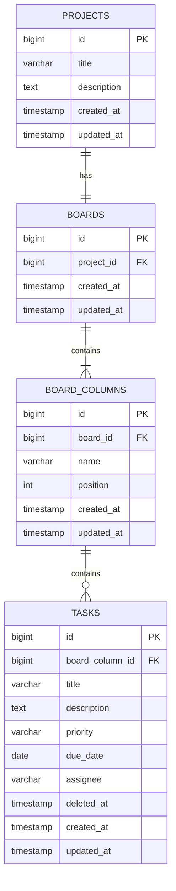

# Модель данных TaskFlow

## 1. Назначение

Этот документ описывает модель данных приложения TaskFlow: основные сущности, их атрибуты, связи между ними и правила хранения данных в PostgreSQL.

Модель данных основана на требованиях MVP, описанных в файле `docs/requirements.md`.

## 2. Основные сущности

В MVP приложения TaskFlow используются четыре основные сущности:

- **Project (Проект)** — проект, в рамках которого пользователь организует работу.
- **Board (Доска)** — доска задач, связанная с одним проектом.
- **BoardColumn (Колонка доски)** — колонка, определяющая этап выполнения задач.
- **Task (Задача)** — отдельная задача, относящаяся к определённой колонке доски.

## 3. Связи между сущностями

- Один проект (`Project`) имеет одну доску (`Board`).
- Одна доска (`Board`) содержит несколько колонок (`BoardColumn`).
- Одна колонка (`BoardColumn`) содержит несколько задач (`Task`).
- Каждая задача принадлежит одной колонке.
- Каждая задача может быть мягко удалена и впоследствии восстановлена.

При создании проекта автоматически создаются связанная доска и три стандартные колонки:
- «К выполнению»;
- «В работе»;
- «Готово».

## 4. Структура таблиц

### 4.1. Таблица `projects`

Таблица хранит информацию о проектах пользователя.

| Поле | Тип данных | Обязательное | Описание |
|---|---|---|---|
| `id` | BIGINT | Да | Уникальный идентификатор проекта |
| `title` | VARCHAR(150) | Да | Название проекта |
| `description` | TEXT | Нет | Описание проекта |
| `created_at` | TIMESTAMP | Да | Дата и время создания |
| `updated_at` | TIMESTAMP | Да | Дата и время последнего изменения |

Ограничения:
- `id` является первичным ключом таблицы.
- Название проекта не может быть пустым.
- `title` не должен превышать 150 символов.
- `created_at` и `updated_at` заполняются автоматически при создании проекта.
- При изменении проекта обновляется значение `updated_at`.

### 4.2. Таблица `boards`

Таблица хранит доски проектов.

| Поле | Тип данных | Обязательное | Описание |
|---|---|---|---|
| `id` | BIGINT | Да | Уникальный идентификатор доски |
| `project_id` | BIGINT | Да | Идентификатор проекта, которому принадлежит доска |
| `created_at` | TIMESTAMP | Да | Дата и время создания |
| `updated_at` | TIMESTAMP | Да | Дата и время последнего изменения |

Ограничения:
- `id` является первичным ключом.
- `project_id` является внешним ключом, ссылающимся на `projects.id`.
- Для одного проекта допускается только одна доска.
- При создании проекта доска создаётся автоматически.

### 4.3. Таблица `board_columns`

Таблица хранит колонки досок.

| Поле | Тип данных | Обязательное | Описание |
|---|---|---|---|
| `id` | BIGINT | Да | Уникальный идентификатор колонки |
| `board_id` | BIGINT | Да | Идентификатор доски |
| `name` | VARCHAR(100) | Да | Название колонки |
| `position` | INTEGER | Да | Порядок отображения колонки |
| `created_at` | TIMESTAMP | Да | Дата и время создания |
| `updated_at` | TIMESTAMP | Да | Дата и время последнего изменения |

Ограничения:
- `id` является первичным ключом.
- `board_id` является внешним ключом, ссылающимся на `boards.id`.
- Название колонки не может быть пустым.
- `position` определяет порядок отображения колонок.
- Колонки одной доски не могут иметь одинаковое значение `position`.
- При создании доски автоматически создаются три колонки: «К выполнению», «В работе» и «Готово».

### 4.4. Таблица `tasks`

Таблица хранит задачи.

| Поле | Тип данных | Обязательное | Описание |
|---|---|---|---|
| `id` | BIGINT | Да | Уникальный идентификатор задачи |
| `board_column_id` | BIGINT | Да | Идентификатор колонки задачи |
| `title` | VARCHAR(200) | Да | Название задачи |
| `description` | TEXT | Нет | Описание задачи |
| `priority` | VARCHAR(20) | Да | Приоритет задачи |
| `due_date` | DATE | Нет | Срок выполнения |
| `assignee` | VARCHAR(150) | Нет | Имя или текстовое обозначение исполнителя |
| `deleted_at` | TIMESTAMP | Нет | Дата и время мягкого удаления |
| `created_at` | TIMESTAMP | Да | Дата и время создания |
| `updated_at` | TIMESTAMP | Да | Дата и время последнего изменения |

Ограничения:
- `id` является первичным ключом.
- `board_column_id` является внешним ключом, ссылающимся на `board_columns.id`.
- Название задачи не может быть пустым.
- Допустимые значения `priority`: `LOW`, `MEDIUM`, `HIGH`, `CRITICAL`.
- При создании задачи приоритет по умолчанию — `MEDIUM`.
- Если `deleted_at` равно `NULL`, задача не удалена.
- Если `deleted_at` содержит дату и время, задача считается мягко удалённой.
- Мягкое удаление не приводит к физическому удалению записи из базы данных.
- Для восстановления задачи значение `deleted_at` устанавливается в `NULL`.

